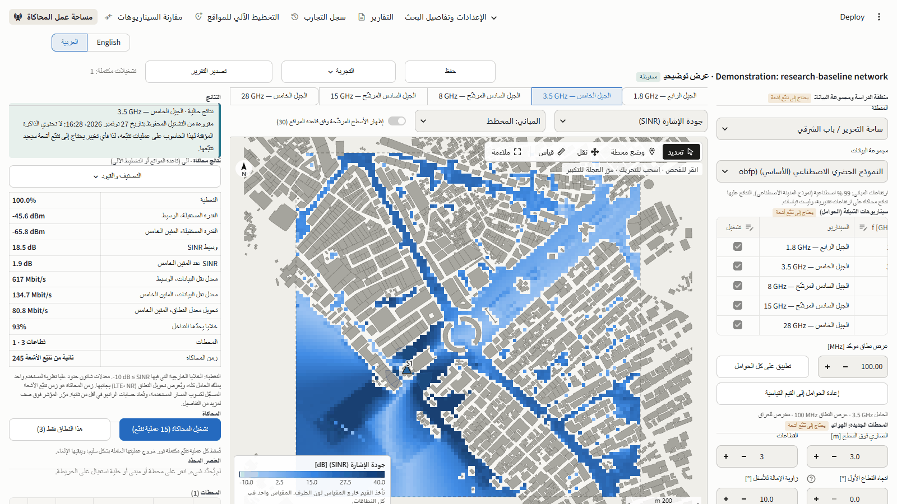
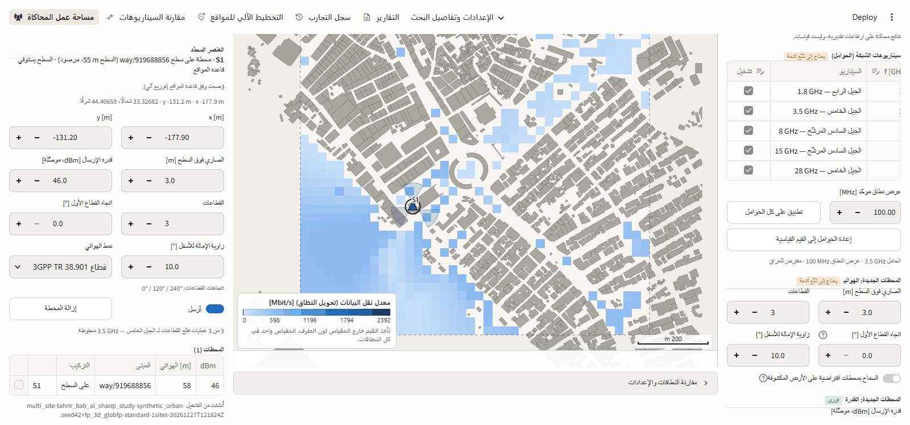
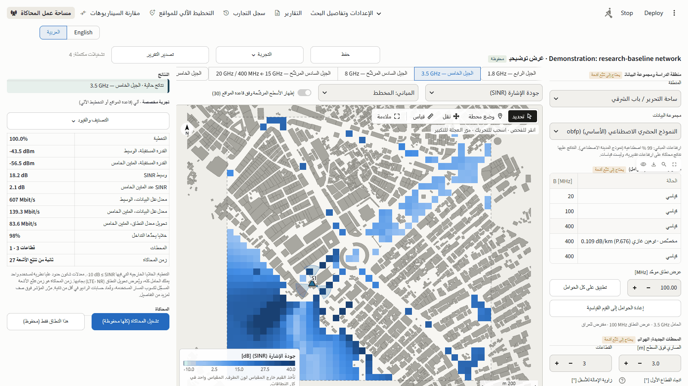
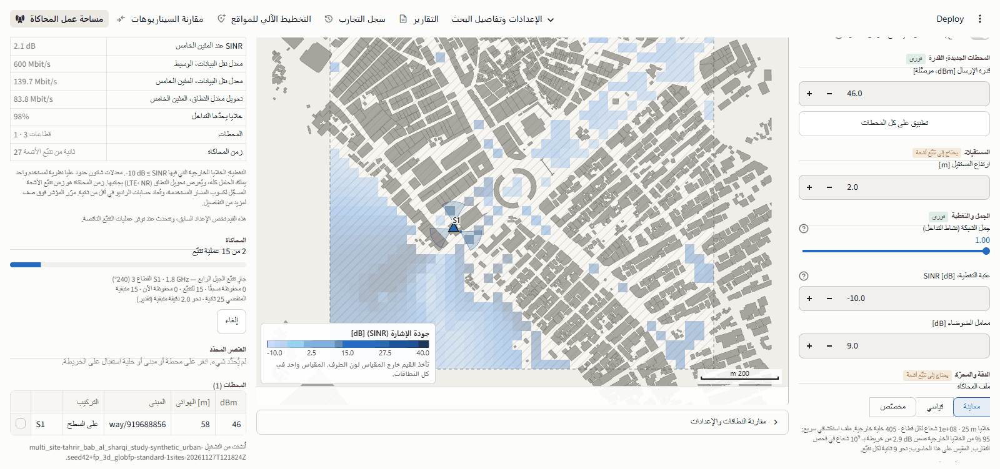
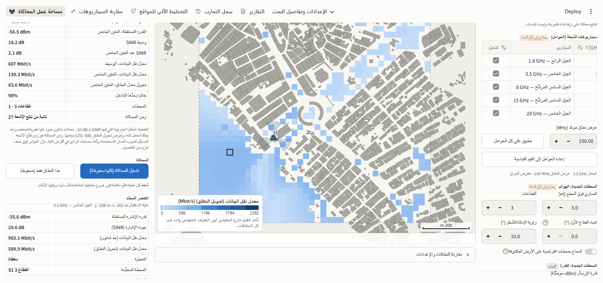
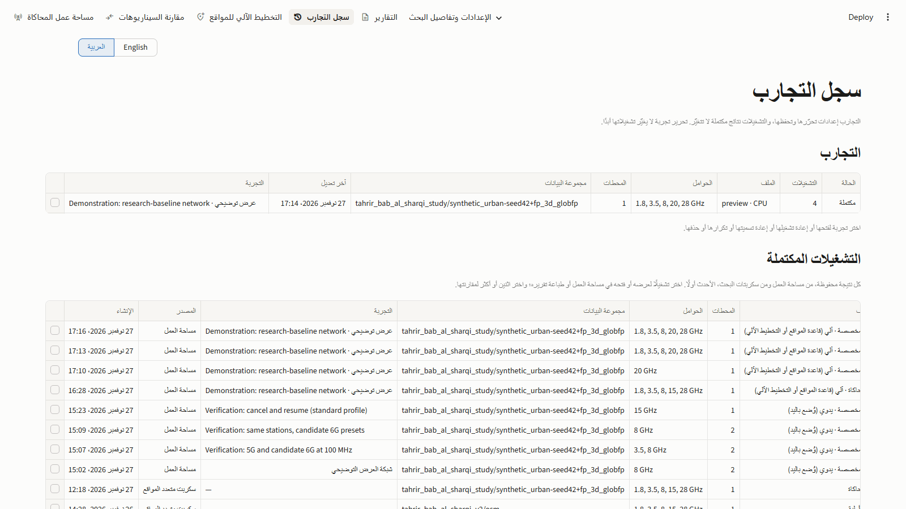
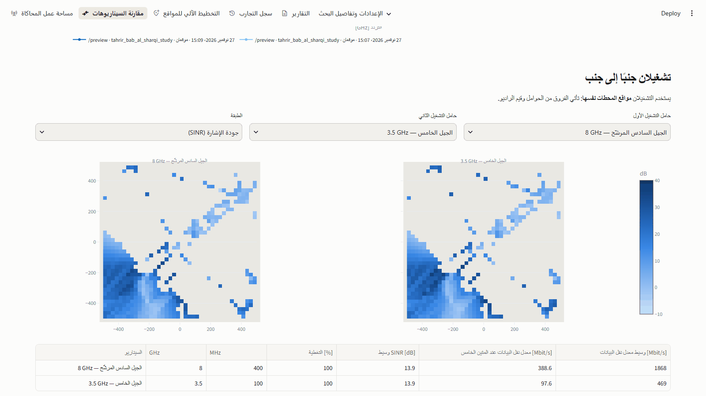

# دليل الاستخدام

للطالب الذي يستخدم محاكي شبكات بغداد على ويندوز. النسخة الإنجليزية: `docs/user-guide.md`.
ولخطوات البحث (من منطقة الدراسة حتى المقارنة مع MATLAB) راجع `docs/research-guide.ar.md`.

محاكي شبكات بغداد محاكٍ تفاعلي لشبكات الراديو: تضع المحطات القاعدية على خريطة منطقة مساحتها كيلومتر
مربع واحد في وسط بغداد، وتختار الشبكة (الجيل الرابع على 1.8 GHz، والجيل الخامس على 3.5 و28 GHz، والجيل
السادس المرشّح على 8 و15 GHz، أو ترددًا تختاره بنفسك)، ثم تشغّل محاكاة بتتبع الأشعة وترى على الخريطة
التغطية والقدرة المستقبلة وجودة الإشارة (SINR) ومعدل نقل البيانات.

أمران يجب تذكرهما:

- **النتائج محاكاة وليست قياسات.** مخططات المباني حقيقية، لكن ارتفاعات معظم المباني تقديرات من
  النموذج الحضري الاصطناعي (القسم 7)، ولا توجد أي قياسات ميدانية.
- **معدلات البيانات نظرية.** معدل شانون هو الحد الأعلى لمستخدم واحد يملك الحامل كله؛ وتحويل النطاق
  المعروض بجانبه (LTE وNR وتقريب مبني على NR للجيل السادس المرشّح) معدل وصلة أقرب إلى الواقع. ولا
  يمثّل أيٌّ منهما الإنتاجية التي تقدّمها شبكة لمستخدمين كثيرين.

الجيل السادس المرشّح على 8 و15 GHz سيناريوهات بحثية، وليس معايير نهائية للجيل السادس.

## 1. ما تحتاجه

- ويندوز 10 أو 11 (64 بت). يُنصح بذاكرة 16 GB، ونحو 6 GB مساحة فارغة على القرص.
- اتصال بالإنترنت عند التثبيت الأول فقط، وبعده يعمل التطبيق دون إنترنت.
- اختياري: بطاقة رسومية من NVIDIA. وبدونها يعمل كل شيء على المعالج (CPU).

لم يُعرف بعد مدى ملاءمة التطبيق لحاسوبك المحمول، فقد طُوِّر واختُبر على حاسوب آخر. شغّل
`Laptop benchmark.cmd` مرة واحدة على حاسوبك (القسم 17) وسلّم النتيجة إلى مشرفك.

## 2. التثبيت (مرة واحدة)

1. إن وسم ويندوز ملف ZIP المُنزَّل بأنه محظور: انقر عليه بالزر الأيمن ← **خصائص (Properties)** ←
   فعّل **Unblock** ← **موافق**.
2. فكّ ضغط الملف إلى مجلد قصير **لا يحتوي مساره حروفًا عربية**، مثل `C:\BaghdadSimulator`
   (بعض برمجيات المشاهد الثلاثية الأبعاد لا تقبل هذه المسارات).
3. افتح المجلد `baghdad-network-simulator` وانقر نقرًا مزدوجًا على **`1 - Install.cmd`**.
4. إن سألتك النافذة عن تثبيت **uv** (مدير حزم بايثون) أو **LLVM** (يستخدمه متتبّع الأشعة) فاكتب
   `Y` واضغط Enter. قد يطلب ويندوز صلاحية المسؤول لتثبيت LLVM: اختر **نعم (Yes)**.
5. يُنزّل التثبيت بايثون وحزمه (نحو 1.2 GB، منها حزمة نماذج الغلاف الجوي من ITU-R بحجم 156 MB)،
   ويبني مجموعات البيانات الخمس من بيانات الخرائط المرفقة، ثم يفحص الحاسوب. انتظر حتى تظهر عبارة
   **Setup complete** ثم اضغط أي مفتاح. وإن ظهر سطر فيه **FAIL** فراجع القسم 18.

إعادة تشغيل `1 - Install.cmd` آمنة: تُحفظ الخطوات المكتملة.

## 3. التشغيل والإيقاف

- **التشغيل:** انقر نقرًا مزدوجًا على **`2 - Start Baghdad Network Simulator.cmd`**. يفتح التطبيق في
  متصفح الإنترنت على العنوان `http://localhost:8501` مباشرة في **مساحة عمل المحاكاة**، ولا يحتاج إلى
  إنترنت.
- **أبقِ النافذة السوداء مفتوحة** أثناء العمل، و**أغلقها** لإيقاف التطبيق.
- إن كان التطبيق يعمل مسبقًا، فالملف نفسه يفتحه في المتصفح فقط.
- لا يمكن الوصول إلى التطبيق إلا من هذا الحاسوب، لا من حواسيب أخرى على الشبكة.

## 4. اللغة

يبدّل المفتاح أعلى الصفحة بين **العربية** و**English** فورًا في كل الصفحات، ويحفظ التطبيق اختيارك
على هذا الحاسوب. تُحفظ أسماء التجارب كما تكتبها تمامًا، بالعربية أو الإنجليزية أو بكلتيهما. تبقى
الأرقام والوحدات والمعرّفات بالحروف اللاتينية، وملفات المحاكاة (CSV وJSON والأشكال) بالإنجليزية.

## 5. مساحة عمل المحاكاة

يفتح التطبيق هنا. يقود الشريط العلوي إلى بقية الأقسام: **مقارنة السيناريوهات** و**التخطيط الآلي
للمواقع** و**سجل التجارب** و**التقارير** و**الإعدادات وتفاصيل البحث** (حالة البحث، ومنطقة الدراسة،
ومعاملات الراديو، والتحقق، وخارطة طريق الجيل السادس).

لمساحة العمل ثلاثة أجزاء:

- **الإعدادات** (يمين الشاشة بالعربية): منطقة الدراسة ومجموعة البيانات، وسيناريوهات الشبكة (الحوامل)،
  وقيم المحطات الجديدة، والمستقبِلات، والحِمل وعتبة التغطية، والدقة والمحرّك. يبيّن كل عنوان هل يحتاج
  التغيير إلى **تتبّع أشعة** (برتقالي) أم هو **فوري** (أخضر).
- **الخريطة** (في الوسط): المباني، والمحطات مع هوائيات قطاعاتها، وطبقة نتائج واحدة. وفوقها تختار
  النطاق والطبقة.
- **النتائج** (الجانب الآخر): حالة النتائج وتصنيفها، والتغطية والقدرة المستقبلة وSINR ومعدلات
  البيانات، وأزرار **تشغيل المحاكاة**، والعنصر المحدَّد، وقائمة المحطات.

يعرض الشريط فوق الأجزاء اسم التجربة وهل هي محفوظة، وأزرار **حفظ** و**التجربة** و**تصدير التقرير**.

عند التشغيل الأول تعرض مساحة العمل التجربة التوضيحية *Demonstration: research-baseline network ·
عرض توضيحي*: محطة واحدة على أعلى سطح مناسب، والسيناريوهات الخمسة، ونتائجها المحفوظة.

## 6. إنشاء تجربة

**التجربة** هي إعدادك: مجموعة البيانات والمحطات والسيناريوهات والإعدادات. و**التشغيل** محاكاة مكتملة
لتجربة، ولا يتغيّر بعد ذلك أبدًا.

1. **التجربة ← تجربة جديدة** تعطيك تجربة فارغة بقيم الإعدادات البحثية الأساسية.
2. أجرِ تعديلاتك ثم اضغط **حفظ** (يظهر بجانب الاسم **تغييرات غير محفوظة** حتى تحفظ). استخدم
   **التجربة ← حفظ باسم** لتسميتها؛ يمكن أن يكون الاسم عربيًا أو إنجليزيًا أو مختلطًا.

## 7. اختيار منطقة الدراسة ومجموعة البيانات

تحت **منطقة الدراسة ومجموعة البيانات** اختر **المنطقة** (منطقة الدراسة *ساحة التحرير / باب الشرقي*
افتراضيًا) و**مجموعة البيانات**.

مجموعة البيانات الافتراضية هي **النموذج الحضري الاصطناعي**: مخططات المباني من OpenStreetMap و3D-GloBFP،
ولمعظم المباني ارتفاع تقديري (بحسب صنف المبنى وعدد طوابقه، وبذرة عشوائية ثابتة). هذه الارتفاعات
ليست قياسات، وتُوسم النتائج عليها بـ *ارتفاعات تقديرية* ولا تُحتسب قياسات أبدًا. انقر مبنى على الخريطة
لترى ارتفاعه ومصدره.

## 8. وضع المحطات القاعدية وضبطها

- **وضع محطة** (شريط أدوات الخريطة) ثم انقر سطحًا: تقف المحطة عند نقطة السطح والصاري فوقه (ارتفاع
  الصاري تحت *المحطات الجديدة: الهوائي*). تُرفض النُّصب التذكارية.
- **أسطح قاعدة المواقع (n)** (تحت *المحطات*) يضع محطات على أعلى الأسطح التي تستوفي قاعدة المواقع،
  بالعدد المكتوب بجانبه: هذا هو التوزيع الآلي.
- **المحطات الافتراضية:** فعّل *السماح بمحطات افتراضية على الأرض المكشوفة* وأدخل ارتفاع الهوائي؛
  عندها تضع النقرة على أرض مكشوفة هوائيًا افتراضيًا (معيّن مفرّغ). ليس موقع تركيب جرى تقييمه،
  والنتائج معه *تجربة مخصّصة*.
- **حدّد** محطة (انقرها أو انقر صفها في قائمة المحطات) لتحريرها: الموضع، وارتفاع الصاري، وقدرة
  الإرسال، والقطاعات، واتجاه القطاع الأول، وزاوية الإمالة، ونمط الهوائي، و**تُرسل** تشغيلًا أو
  إيقافًا. **إزالة المحطة** (أو مفتاح Delete) يحذفها.
- **نقل** (شريط الأدوات): اسحب المحطة إلى سطح آخر.
- **قياس** (شريط الأدوات): انقر نقطتين لترى المسافة بينهما.
- اسحب الخريطة للتحريك، ومرّر العجلة للتكبير، و**ملاءمة** لعرض المنطقة كلها.

## 9. اختيار الجيل الرابع أو الخامس أو السادس المرشّح

يعرض جدول **سيناريوهات الشبكة (الحوامل)** السيناريوهات الخمسة. فعّل **تشغيل** للسيناريوهات التي
تريد محاكاتها، واختر من الأزرار فوق الخريطة السيناريو الذي تعرضه الخريطة. للجيل السادس المرشّح (8
و15 GHz) الأدوات نفسها تمامًا التي للجيلين الرابع والخامس.

## 10. تغيير التردد وعرض النطاق

- عدّل **f [GHz]** أو **B [MHz]** في الجدول، فيصبح الصف *مخصّصًا*: تصير النتيجة *تجربة مخصّصة*،
  وتبقى قيم الراديو وتحويل المعدل الخاصة بالسيناريو.
- لا يُقبل التردد إلا حيث تكون كل النماذج معرّفة: مادة المباني (الخرسانة في متتبّع الأشعة) ونموذج
  الغازات الجوية (ITU-R P.676) ونموذج الهوائي. مع هوائي القطاع القياسي يكون المدى **من 1 إلى 100
  GHz**. ويجب ألا يتجاوز عرض النطاق ربع التردد. وتُرفض القيم الأخرى مع ذكر السبب.
- **عرض نطاق موحّد** يعطي كل السيناريوهات عرض النطاق نفسه لمقارنة منصفة بين الترددات. **إعادة الحوامل
  إلى القيم القياسية** تلغي القيم المخصّصة، و**العودة إلى الإعدادات البحثية الأساسية** تستعيد كل
  القيم الأساسية (تبقى المحطات في مواضعها).

## 11. تشغيل المحاكاة وإلغاؤها

- **تشغيل المحاكاة (n عملية تتبّع)** يتتبّع الناقص لكل السيناريوهات المفعّلة، و**هذا النطاق فقط**
  يتتبّع النطاق المعروض على الخريطة. تُعاد الاستفادة من عمليات التتبّع المنجزة سابقًا (من أي تجربة)،
  فلا يُحسب إلا الناقص. تُحفظ التجربة أولًا.
- تعرض اللوحة النطاق والمحطة والقطاع الجاري تتبّعه، وعدد العمليات المحفوظة مسبقًا والمحفوظة الآن
  والمتبقية، والإعادات، والزمن المنقضي، وتقديرًا للمتبقي. التقدير ليس وعدًا.
- **إلغاء** يوقف عملية التتبّع الجارية. وتبقى كل عملية حُفظت محفوظة، ويستأنف التشغيل التالي من حيث توقف.
- المدة: ملف **معاينة** (خلايا 25 m) يستغرق ثواني لكل عملية تتبّع، و**قياسي** (خلايا 10 m، الإعدادات
  البحثية الأساسية) نحو دقيقة ونصف لكل عملية على حاسوب التطوير. تجعل خطة الطاقة **Power saver** في
  ويندوز تتبّع الأشعة أبطأ بنحو الضعف، وتنبّهك مساحة العمل إن كانت مفعّلة.
- تبقى الصفحة قابلة للاستخدام أثناء المحاكاة، ولا تعمل إلا محاكاة واحدة في كل مرة.

## 12. فحص النتائج

- اختر الطبقة فوق الخريطة: **قدرة الإشارة المستقبلة**، **جودة الإشارة (SINR)**، **التغطية**، **معدل
  نقل البيانات (حد شانون)**، **معدل نقل البيانات (تحويل النطاق)**، **المحطة المخدِّمة**، **التداخل**،
  **كسب المسار**. يبيّن مفتاح الألوان المقياس، والمقياس واحد في كل النطاقات.
- حرّك المؤشر فوق الخريطة لقراءة القيمة تحته، وانقر خلية في الشارع لترى كل قيمها في اللوحة.
- **النتائج القديمة:** إن غيّرت شيئًا يحتاج إلى تتبّع أشعة (موضع محطة أو ارتفاعها أو اتجاهها أو
  إمالتها، أو ارتفاع المستقبِل، أو الدقة) تبهت الخريطة وتُوسم *نتائج الإعداد السابق*. شغّل المحاكاة
  مجددًا لتحديثها. أما القدرة ومعامل الضوضاء والحِمل وعتبة التغطية فتتحدث فورًا.
- **مقارنة النطاقات والإعدادات** (تحت الخريطة) تعرض الطبقة نفسها في كل النطاقات بمقياس واحد، وتقارن
  الإعداد الحالي بإعداد ثبّتّه مرجعًا.

## 13. حفظ التجارب وإعادة فتحها وتكرارها

- **التجربة ← فتح** يعيد فتح تجربة محفوظة، و**تكرار** ينشئ نسخة، و**إعادة التسمية** يغيّر الاسم،
  و**حذف…** يطلب التأكيد وينقلها إلى `outputs\experiments\.deleted\` (تبقى تشغيلاتها).
- **سجل التجارب** يعرض كل التجارب وكل التشغيلات. اختر تجربة لفتحها أو إعادة تشغيلها أو إعادة
  تسميتها أو تكرارها أو حذفها، واختر تشغيلًا لعرضه أو فتحه في مساحة العمل أو طباعة تقريره، أو اختر
  تشغيلين لمقارنتهما.

## 14. مقارنة الجيل الخامس والجيل السادس المرشّح بالمحطات نفسها

1. أعدّ تجربة للجيل الخامس وشغّلها.
2. **التجربة ← تكرار كتجربة جيل سادس مرشّح**: نسخة بالمحطات نفسها تحاكي سيناريوهي الجيل السادس
   المرشّح. شغّلها (تُعاد الاستفادة من عمليات التتبّع الموجودة).
3. في **سجل التجارب** اختر التشغيلين واضغط **مقارنة (2)**، أو افتح **مقارنة السيناريوهات ← بين
   التشغيلات**. يعرض *تشغيلان جنبًا إلى جنب* طبقة واحدة لنطاق من كل تشغيل بالمقياس نفسه، ويبيّن هل
   مواقع المحطات متطابقة.

## 15. تصدير تقرير

**تصدير التقرير** (الشريط العلوي) يُعدّ التقرير القابل للطباعة لأحدث تشغيل للتجربة بلغة الواجهة،
و**تنزيل التقرير** يحفظه (افتحه في المتصفح واطبعه إلى PDF). وتوفّر صفحة **التقارير** الشيء نفسه لأي
تشغيل، مع الإعدادات والمصدر والإحصاءات وملفات البيانات.

## 16. معنى الوسوم على النتائج

تحمل كل نتيجة تصنيفها:

| الوسم | المعنى |
|---|---|
| نتائج محاكاة | الإعدادات البحثية الأساسية على ارتفاعات مبانٍ تقديرية (اصطناعية): محاكاة بافتراضات معلنة، وليست نتيجة جرى التحقق منها. |
| تجربة مخصّصة | تختلف بعض الإعدادات عن الإعدادات البحثية الأساسية (مثل ملف المعاينة، أو تردد مخصّص، أو قدرة خاصة بمحطة، أو محطة افتراضية)، وتذكرها التفاصيل. |
| تحليل حساسية | لا تختلف إلا عتبة التغطية أو الحِمل أو المطر عن الإعدادات الأساسية. |
| محاكاة أولية | ارتفاعات مبانٍ مؤقتة أو إعداد غير مسجّل (تشغيلات أقدم). |
| نتائج بحثية مستوفية للتحقق | لم تتحقق بعد: تحتاج إلى بيانات مبانٍ مقيسة كاملة، وفحص التقارب النهائي، والمقارنة مع MATLAB. |

يُعرض **توزيع المحطات** منفصلًا: *آلي* (قاعدة المواقع)، أو *يدوي* (وُضعت باليد على سطح)، أو *افتراضي*
(أرض مكشوفة). وتعني «التحقق العلمي قيد الانتظار» أن الفحوص العددية للدراسة النهائية لم تُنجز بعد.
**لا توجد في هذه الحزمة نتيجة هي قياس أو نتيجة بحثية مستوفية للتحقق.**

## 17. الفحص وقياس الأداء

- **`Diagnose problems.cmd`** يفحص بايثون والحزم وLLVM والذاكرة والقرص وخطة الطاقة ومجموعات البيانات
  وملفات الحزمة (مقارنةً بالملف `SHA256SUMS.txt`) واختبارًا قصيرًا لتتبع الأشعة. كل سطر نتيجته PASS
  أو WARN أو FAIL، ويحفظ تقريرًا في `outputs\acceptance\` يمكنك إرساله إلى مشرفك.
- **`Laptop benchmark.cmd`** يقيس أزمنة التشغيل على حاسوبك المحمول (صِل الشاحن؛ يستغرق وقتًا).
  تُحفظ النتائج في `outputs\acceptance\<الوقت>\`، وراجع `docs/laptop-acceptance.md`.

## 18. حل المشكلات

| ما تراه | ما تفعله |
|---|---|
| رسالة "Windows protected your PC" أو تحذير أمني عند النقر المزدوج | **More info ← Run anyway** (أو **Run**). يمكن تجنّبها بإلغاء حظر ملف ZIP قبل فكّه (القسم 2). |
| أثناء التثبيت: "uv is not installed" أو "LLVM ... was not found" | شغّل `1 - Install.cmd` مرة أخرى وأجب بـ `Y`. وإن لم يتوفر winget فنفّذ الأمر الذي يطبعه في نافذة PowerShell ثم أعد التثبيت. |
| أثناء التثبيت: "uv sync failed" | التثبيت الأول يحتاج إلى الإنترنت (حجم إحدى الحزم 156 MB). اتصل بالإنترنت وشغّل `1 - Install.cmd` مرة أخرى. |
| لم يفتح المتصفح | افتح العنوان `http://localhost:8501` بنفسك (تُظهر النافذة السوداء العنوان). |
| رسالة "This site can't be reached" | أُغلقت النافذة السوداء. شغّل التطبيق مرة أخرى. |
| يظهر منفذ آخر في العنوان (8502 …) | برنامج آخر يستخدم المنفذ 8501، فاختار التطبيق المنفذ الحر التالي. |
| تظهر إعادة في المحاكاة | على ويندوز يتوقف أحيانًا التشغيل الأول من نوع جديد عند انتهاء عملية عاملة، فتُحسب عملية التتبّع تلك مجددًا تلقائيًا. |
| فشلت محاكاة | افتح **سجل التجارب ← عمليات المحاكاة في الخلفية** واقرأ سجلها. |
| المحاكاة أبطأ كثيرًا من المتوقع | صِل الشاحن، واترك خطة الطاقة Power saver، وامنع الحاسوب من السكون. |
| يُرفض تردد | هو خارج المدى 1-100 GHz لهوائي القطاع، أو يتجاوز عرض النطاق ربعه (القسم 10). |
| الفحص: "package files … changed" | عُدّل ملف من ملفات الحزمة. إن لم تقصد ذلك ففكّ ضغط الحزمة مرة أخرى. |
| أي مشكلة أخرى | شغّل `Diagnose problems.cmd` وأرسل التقرير المحفوظ إلى مشرفك. |

## 19. أين تجد ملفاتك

- تجاربك: `outputs\experiments\` (ملف لكل تجربة، والمحذوفة في `.deleted\`).
- نتائج المحاكاة: `outputs\runs\development\<التشغيل>\` (البيان، والإحصاءات، والخرائط، وCSV). تضم الحزمة
  التجربة التوضيحية وتشغيلها، والتشغيل بالإعدادات البحثية الأساسية الذي بُنيت منه، وتشغيلات أولية
  أقدم على منطقة التطوير (دون ملفات CSV الخاصة بكل خلية).
- تُحفظ كسوب المسار المتتبَّعة في `data\cache\pathgain\` ويُعاد استخدامها في كل التجارب.
- التقارير والملفات المصدَّرة: مجلد التنزيلات في متصفحك.
- توصياتك في خارطة طريق الجيل السادس: `outputs\roadmap\student_recommendations.json`.
- اختيارك للغة: `outputs\app_state\preferences.json`.

لإزالة التطبيق احذف مجلده. ويمكن إزالة uv وLLVM من **الإعدادات ← التطبيقات** في ويندوز.

