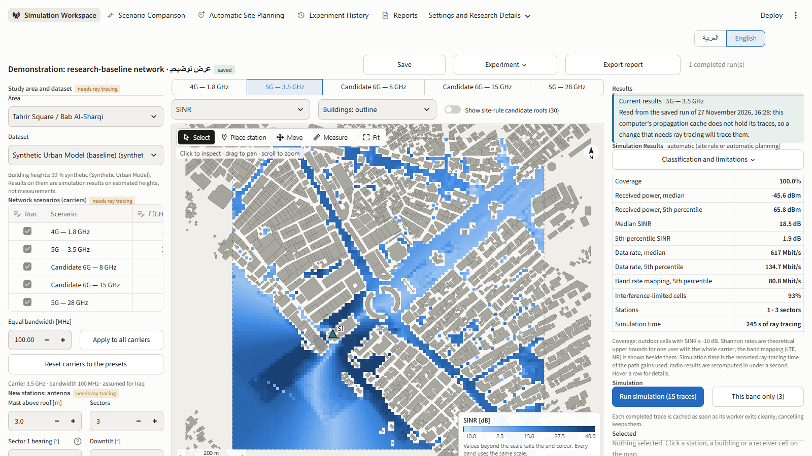
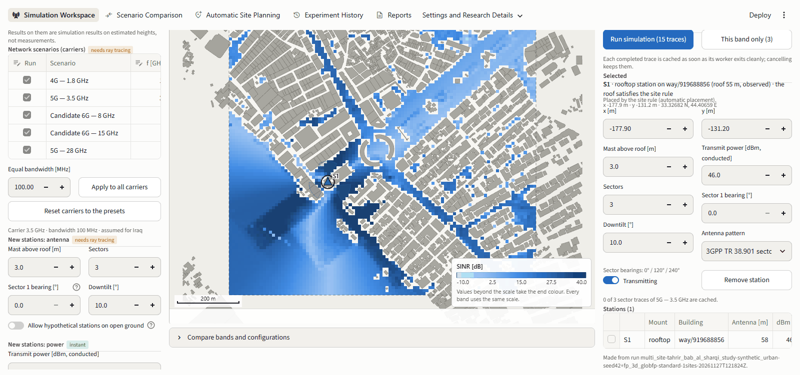
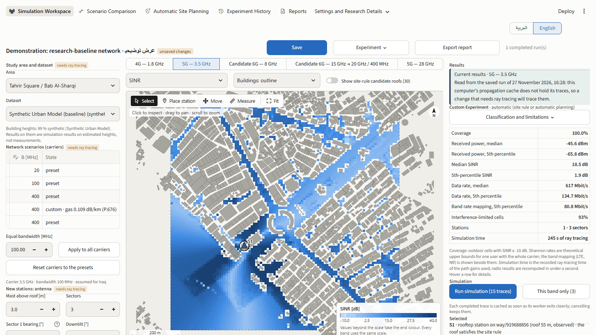
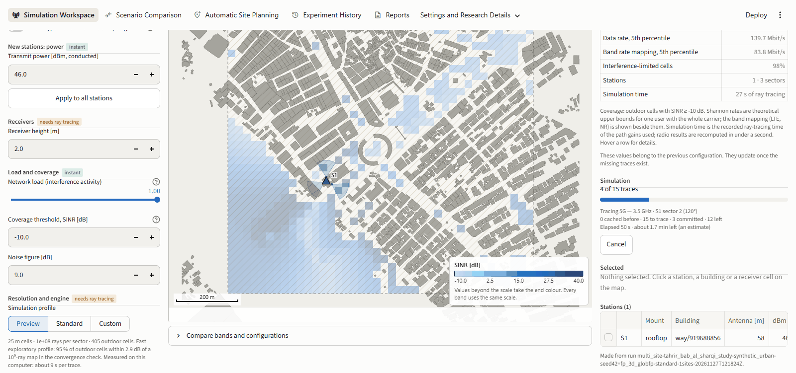
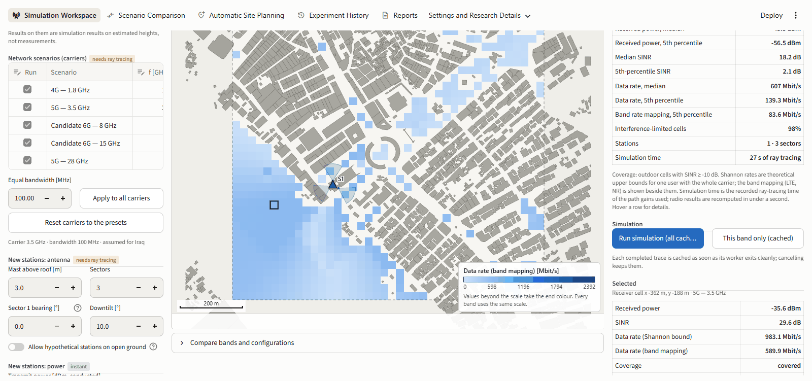
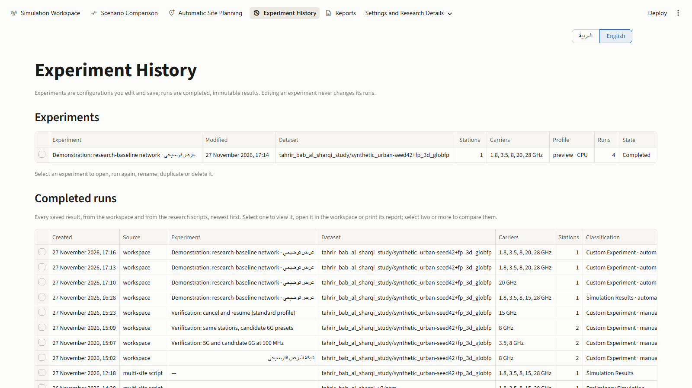
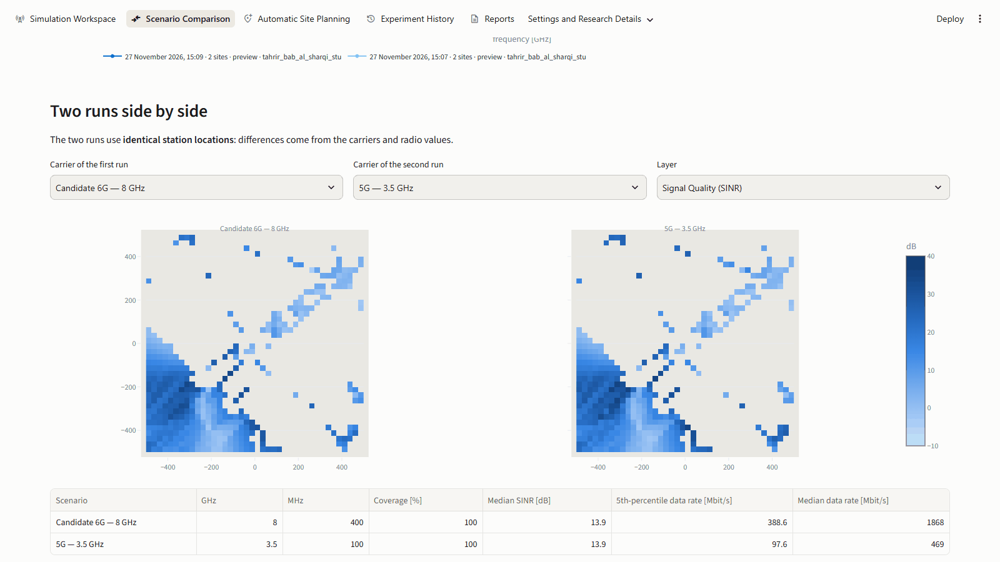

# User guide

For the student using the Baghdad Network Simulator on Windows. Arabic version:
`docs/user-guide.ar.md`. For the research steps (study area to MATLAB comparison) see
`docs/research-guide.md`.

The Baghdad Network Simulator is an interactive radio-network simulator. You place base stations on a
map of a 1 km² district of central Baghdad, choose the network (4G at 1.8 GHz, 5G at 3.5 and 28 GHz,
candidate 6G at 8 and 15 GHz, or your own frequency), run a ray-tracing simulation and look at the
coverage, received power, signal quality (SINR) and data rate on the map.

Two things to keep in mind:

- **The results are simulations, not measurements.** The building footprints are real, but almost all
  building heights are estimates from the Synthetic Urban Model (section 7), and no field measurement
  exists.
- **Data rates are theoretical.** The Shannon rate is the upper bound for one user with the whole
  carrier; the band mapping beside it (LTE, NR, and an NR-based approximation for candidate 6G) is a
  more realistic link rate. Neither is the throughput a network would deliver to many users.

Candidate 6G at 8 and 15 GHz are research scenarios, not finished 6G standards.

## 1. What you need

- Windows 10 or 11 (64-bit). 16 GB of memory is recommended; about 6 GB of free disk space.
- Internet access for the first installation only. Afterwards the application works offline.
- Optional: an NVIDIA graphics card. Without one, everything runs on the processor (CPU).

Whether the application runs well on your own laptop is not yet known: it was developed and tested on
another computer. Run `Laptop benchmark.cmd` once on your laptop (section 17) and give the result to
your supervisor.

## 2. Install (once)

1. If Windows marks the downloaded ZIP file as blocked: right-click it → **Properties** → tick
   **Unblock** → **OK**.
2. Extract the ZIP to a short folder whose path has **no Arabic letters**, for example
   `C:\BaghdadSimulator`. (Some of the 3-D software does not accept such paths.)
3. Open the folder `baghdad-network-simulator` and double-click **`1 - Install.cmd`**.
4. If the window asks to install **uv** (the Python package manager) or **LLVM** (used by the ray
   tracer), type `Y` and press Enter. For LLVM, Windows may ask for administrator permission: choose
   **Yes**.
5. The installation downloads Python and its packages (about 1.2 GB, including a 156 MB package of
   ITU-R atmospheric models), builds the five datasets from the included map data and checks the
   computer. Wait until it says **Setup complete**, then press a key. If a line says **FAIL**, see
   section 18.

Running `1 - Install.cmd` again is safe: finished steps are kept.

## 3. Start and stop

- **Start:** double-click **`2 - Start Baghdad Network Simulator.cmd`**. The application opens in your
  web browser at `http://localhost:8501`, directly in the **Simulation Workspace**. No internet is needed.
- **Keep the black window open** while you work. **Close it** to stop the application.
- If the application is already running, the same file just opens it in the browser.
- The application is reachable only from this computer, not from other computers on the network.

## 4. Language

The switch at the top right changes between **العربية** and **English** at once, on every page. Your
choice is remembered on this computer. Experiment names are kept exactly as you type them, in Arabic,
English or both. Numbers, units and identifiers stay in Latin characters; files written by simulations
(CSV, JSON, figures) are in English.

## 5. The Simulation Workspace

The application opens here. The bar at the top leads to the other sections: **Scenario Comparison**,
**Automatic Site Planning**, **Experiment History**, **Reports** and **Settings and Research Details**
(research status, study area, radio parameters, validation and the 6G roadmap).

The workspace has three parts:

- **Settings** (right in Arabic, left in English): study area and dataset, the network scenarios
  (carriers), values for new stations, receivers, load and coverage threshold, resolution and engine.
  Every heading says whether a change **needs ray tracing** (orange) or is **instant** (green).
- **Map** (middle): buildings, stations with their sector antennas, and one result layer. Above it you
  choose the band and the layer.
- **Results** (the other side): the state of the results, their classification, coverage, received
  power, SINR and data rates, the **Run simulation** buttons, the selected object and the station list.

The bar above the panels shows the experiment's name, whether it is saved, and the **Save**,
**Experiment** and **Export report** buttons.

On first start the workspace shows the demonstration experiment *Demonstration: research-baseline
network*: one station on the tallest suitable roof, the five scenarios, and its saved results.

## 6. Create an experiment

An **experiment** is your configuration: dataset, stations, scenarios and settings. A **run** is a
finished simulation of an experiment; it is never changed afterwards.

1. **Experiment → New experiment** gives an empty experiment with the research-baseline values.
2. Make your changes, then press **Save** (the name shows **unsaved changes** until you do). Use
   **Experiment → Save as** to give it a name; names may be Arabic, English or mixed.

## 7. Select the study area and the dataset

Under **Study area and dataset** choose the **Area** (the study district *Tahrir Square / Bab
Al-Sharqi* by default) and the **Dataset**.

The default dataset is the **Synthetic Urban Model**: building footprints from OpenStreetMap and
3D-GloBFP, and for almost every building an estimated height (by building class and floor count, a fixed
random seed). These heights are not measured; results on them are labelled *Estimated Building Heights*
and never count as measurements. Click a building on the map to see its height and where it comes from.

## 8. Place and configure base stations

- **Place station** (map toolbar), then click a roof: the station stands at the roof's rooftop point
  with the mast on top (the mast height is under *New stations: antenna*). Monuments are refused.
- **Site-rule roofs (n)** (under *Stations*) places stations on the tallest roofs that satisfy the site
  rule, as many as the number beside it: this is the automatic placement.
- **Hypothetical stations:** switch on *Allow hypothetical stations on open ground* and enter an
  antenna height; a click on open ground then gives a hypothetical antenna (hollow diamond). It is not
  an assessed installation site, and results with it are a *Custom Experiment*.
- **Select** a station (click it, or a row of the station list) to edit it on the right: position,
  mast height, transmit power, sectors, the bearing of sector 1, downtilt, antenna pattern, and
  **Transmitting** on or off. **Remove station** (or the Delete key) removes it.
- **Move** (toolbar): drag a station to another roof.
- **Measure** (toolbar): click two points to see their distance.
- Drag the map to pan, scroll to zoom, **Fit** to see the whole area.

## 9. Select 4G, 5G or candidate 6G

The table **Network scenarios (carriers)** lists the five scenarios. Tick **Run** for the ones to
simulate. The buttons above the map choose which one the map shows. Candidate 6G (8 and 15 GHz) has
exactly the same tools as 4G and 5G.

## 10. Change frequency and bandwidth

- Edit **f [GHz]** or **B [MHz]** in the table. The row then says *custom*: the result becomes a
  *Custom Experiment*, and the scenario's radio values and rate mapping are kept.
- Frequencies are accepted only where every model is defined: the building material (concrete in the
  ray tracer), the atmospheric gas model (ITU-R P.676) and the antenna model. With the standard sector
  antenna that is **1 to 100 GHz**. The bandwidth must be at most a quarter of the frequency. Other
  values are refused with the reason.
- **Equal bandwidth** gives every scenario the same bandwidth, for a fair comparison between
  frequencies. **Reset carriers to the presets** undoes custom values; **Reset to the research
  baseline** restores all baseline values (stations keep their positions).

## 11. Run and cancel a simulation

- **Run simulation (n traces)** traces what is missing for all ticked scenarios; **This band only**
  traces the band on the map. Traces already done (by any experiment) are reused, so only the
  missing ones are computed. The experiment is saved first.
- The panel shows the band, station and sector being traced, how many traces are cached, committed and
  left, retries, the elapsed time and an estimate. The estimate is not a promise.
- **Cancel** stops the trace in progress. Every trace already committed stays saved; running again
  continues from there.
- How long it takes: the **Preview** profile (25 m cells) takes seconds per trace; **Standard** (10 m
  cells, the research baseline) about 1.5 minutes per trace on the development computer. A Windows
  **Power saver** plan makes ray tracing about twice as slow; the workspace tells you when it is on.
- The page stays usable while a simulation runs. Only one simulation runs at a time.

## 12. Inspect the results

- Choose the layer above the map: **Received power**, **SINR**, **Coverage**, **Data rate (Shannon
  bound)**, **Data rate (band mapping)**, **Serving station**, **Interference** or **Path gain**. The
  legend shows the scale; every band uses the same scale.
- Move the mouse over the map to read the value under it; click a street cell to see all its values on
  the right.
- **Stale results:** if you change something that needs ray tracing (a station's position, height,
  bearing or downtilt, the receiver height, the resolution), the map is faded and marked *Results of
  the previous configuration*. Run the simulation again to update. Power, noise figure, load and the
  coverage threshold update at once.
- **Compare bands and configurations** (below the map) shows the same layer in every band on one scale,
  and compares the current configuration with one you pinned.

## 13. Save, reopen and duplicate experiments

- **Experiment → Open** reopens a saved experiment; **Duplicate** makes a copy; **Rename** renames it;
  **Delete…** asks for confirmation and moves it to `outputs\experiments\.deleted\` (its runs stay).
- **Experiment History** lists all experiments and all runs. Select an experiment to open it, run it
  again, rename, duplicate or delete it; select a run to view it, open it in the workspace, print its
  report, or select two runs to compare them.

## 14. Compare 5G and candidate 6G with identical stations

1. Set up and run a 5G experiment.
2. **Experiment → Duplicate as candidate 6G**: a copy with the same stations, simulating the two
   candidate 6G scenarios. Run it (traces that already exist are reused).
3. In **Experiment History** select both runs and press **Compare (2)**, or open **Scenario
   Comparison → Across runs**. *Two runs side by side* shows one layer of a band of each run on the
   same scale and says whether the station locations are identical.

## 15. Export a report

**Export report** (top bar) prepares the printable report of the experiment's newest run in the
interface language; **Download report** saves it (open it in the browser and print to PDF). The
**Reports** page offers the same for any run, with configuration, provenance, statistics and data files.

## 16. What the labels on results mean

Every result carries its classification:

| Label | Meaning |
|---|---|
| Simulation Results | Research-baseline settings on estimated (synthetic) building heights: a simulation under stated assumptions, not a validated finding. |
| Custom Experiment | Some settings differ from the research baseline (for example the preview profile, a custom frequency, a station's own power, or a hypothetical station); the details list them. |
| Sensitivity Analysis | Only the coverage threshold, load or rain differ from the baseline. |
| Preliminary Simulation | Placeholder building heights or an unrecorded configuration (older runs). |
| Validated Research Results | Not reached yet: needs complete measured building data, the final convergence check and the MATLAB comparison. |

**Placement** is shown separately: *automatic* (site rule), *manual* (placed by hand on a roof) or
*hypothetical* (open ground). "Validation Pending" means the numerical checks of the final study are not
done yet. **No result in this package is a measurement or a validated research result.**

## 17. Diagnostics and benchmark

- **`Diagnose problems.cmd`** checks Python, the packages, LLVM, memory, disk, the power plan, the
  datasets, the package files (against `SHA256SUMS.txt`) and a short ray-tracing test. Each line is
  PASS, WARN or FAIL. It saves a report in `outputs\acceptance\` that you can send to your supervisor.
- **`Laptop benchmark.cmd`** measures run times on your laptop (connect the charger; it takes a while).
  Results go to `outputs\acceptance\<time>\`; see `docs/laptop-acceptance.md`.

## 18. Troubleshooting

| What you see | What to do |
|---|---|
| "Windows protected your PC" or a security warning when double-clicking | **More info → Run anyway** (or **Run**). Unblocking the ZIP before extracting (section 2) avoids it. |
| Installation: "uv is not installed" / "LLVM ... was not found" | Run `1 - Install.cmd` again and answer `Y`. Without winget, run the command it prints in a PowerShell window, then install again. |
| Installation: "uv sync failed" | The first installation needs internet (one package is 156 MB). Connect and run `1 - Install.cmd` again. |
| The browser did not open | Open `http://localhost:8501` yourself (the black window shows the address). |
| "This site can't be reached" | The black window was closed. Start the application again. |
| The address shows another port (8502 …) | Port 8501 is used by another program; the application took the next free one. |
| A simulation shows a retry | On Windows the first run of a new kind sometimes stops when a worker ends; that trace is computed again automatically. |
| A simulation failed | Open **Experiment History → Background simulations** and read its log. |
| Simulations are much slower than expected | Connect the charger, leave the Power saver plan, keep the laptop awake. |
| A frequency is refused | It is outside 1-100 GHz for the sector antenna, or the bandwidth exceeds a quarter of it (section 10). |
| Diagnostics: "package files … changed" | A delivered file was edited. If you did not mean to, extract the package again. |
| Anything else | Run `Diagnose problems.cmd` and send the saved report to your supervisor. |

## 19. Where your files are

- Your experiments: `outputs\experiments\` (one file each; deleted ones in `.deleted\`).
- Simulation results: `outputs\runs\development\<run>\` (manifest, statistics, maps, CSV). The package
  includes the demonstration experiment and its run, the research-baseline run it comes from, and older
  preliminary runs on the development area (without their per-cell CSV files).
- Traced path gains are kept in `data\cache\pathgain\` and reused by every experiment.
- Downloaded reports and exports: your browser's Downloads folder.
- Your 6G roadmap recommendations: `outputs\roadmap\student_recommendations.json`.
- Your language choice: `outputs\app_state\preferences.json`.

To remove the application, delete its folder. uv and LLVM can be removed in Windows
**Settings → Apps**.
